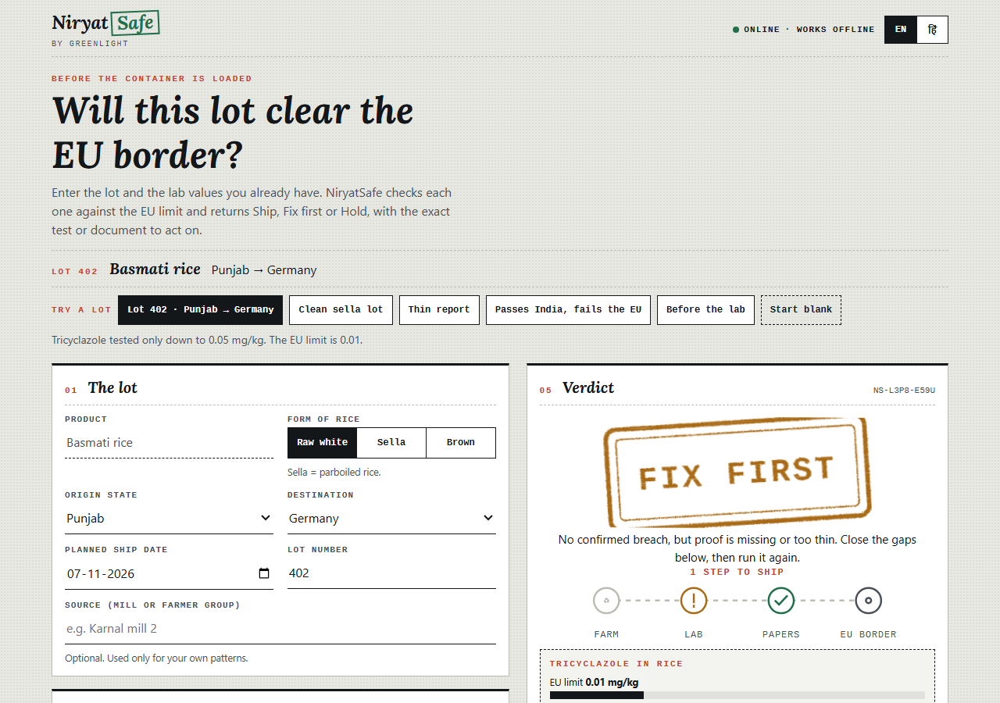
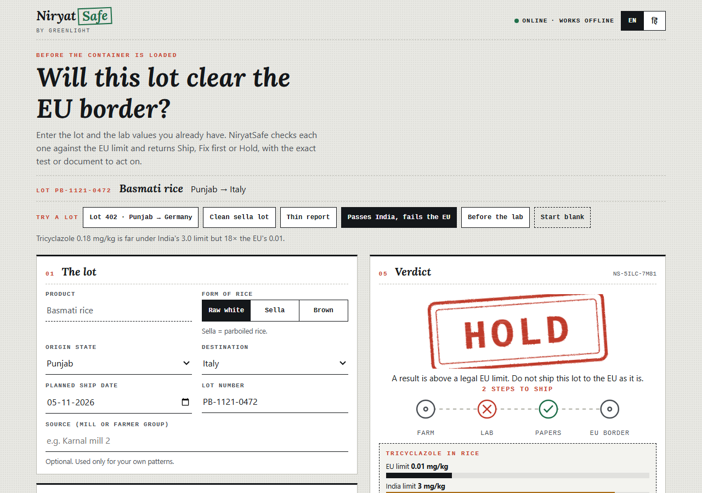
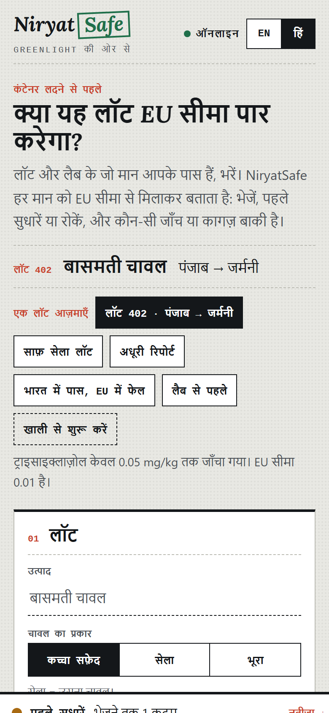

# NiryatSafe [Runner Up HACKDAY 2026 HACKATHON BY MLH]

**Check your basmati lot at your own gate, before the EU checks it at theirs.**
Team GREENLIGHT · Hacktoberfest Hack Day 2026 · MIT

A lot of basmati can pass India's checks and still be refused whole at the EU border. NiryatSafe takes the lot and the lab values
you already have, compares each one with the **destination's** limit, and answers **Ship**, **Fix first** or **Hold**, with the exact test
or document still missing. Fixed rules, every verdict linked to its source, **no LLM in the decision path**. Hindi and English, works offline.

| Lot 402: FIX FIRST | Passes India, fails the EU: HOLD | Hindi, on a phone |
|---|---|---|
|  |  |  |

## Try it (pick one)
```bash
open web/dist/niryatsafe-standalone.html     # nothing to install: one file, works offline
make run-lite                                
make setup && make run                       
```
Watch the 30-second walkthrough: `docs/demo/fallback-demo.webm`. Tests: `make test` (Python, JS, and a Python/JS parity check). Browser check: `make e2e`.

## How a verdict is made
- **HOLD**: a measured value is above a **legal** limit. Only rules whose basis is `law` can do this.
- **FIX FIRST**: nothing is proven wrong, but proof is missing or weak: an untested pesticide, a lab that only tests down to 0.05 when the limit is 0.01,
  a result at 80-100% of the limit, a stale or unlinked report, a missing paper. *Unknown is never treated as a pass.*
- **SHIP**: everything required is evidenced and inside the limits.

What you sprayed becomes required tests. What the refusal data says (EU alerts on Indian rice, 2015 onward) ranks the tests and sets a risk flag; it never changes a verdict.
No specific limit for a substance? The EU default of 0.01 mg/kg applies. The chart "Pass India, fail the EU" shows India's limit next to the EU's.

## Rules are rows
`rules/limits.csv`, one rule per row, **a new market is new rows, not new code**:

```csv
product,substance,market,limit_mg_kg,source,form,basis,note
rice,tricyclazole,EU,0.01,reg_2017_983;ls_1314_2024,,law,EU limit for rice (LOQ)
rice,tricyclazole,IN,3.0,ls_2057_2025,,reported,India (FSSAI) limit as quoted by the Government of India
```
`python -m niryatsafe.rulebook build` turns the rows (plus names, documents and translations) into one versioned, hashed **rules pack**
that the server publishes and the app caches. Details: [docs/RULES.md](docs/RULES.md).

## Repo map
```
rules/        limits.csv (the rules), rulebook.yaml (sources, markets, documents), i18n.json, ui.json, samples.json, REVIEW.json
niryatsafe/   engine.py (deterministic engine), rulebook.py (rules pack builder), labparse.py, service.py, api.py (FastAPI), serve.py (stdlib)
pipeline/     pandas -> SQLite: RASFF + FDA loaders, signals, back-test, limits-diff
web/          React PWA: src/engine.js (offline twin of the engine), build.mjs (esbuild), dist/ (built), tests/
tests/        unittest suite incl. Python<->JS parity vectors      scripts/  e2e, demo recording, fixtures, assets
docs/         ARCHITECTURE, DATA, RULES, DEMO_SCRIPT, DECK_COMPLIANCE, screens, demo video
```


